 

  

 

## ⚡ About me

- 🧪 **AI Engineer at Capgemini**, building **LLM evaluation frameworks** for production RAG and GenAI systems
- 🎯 I make AI **measurable**: golden datasets, LLM-as-a-judge, retrieval & generation metrics, end-to-end tracing
- 🔭 Currently building **[jfuse](https://github.com/LightningJake/jfuse)**, local-first LLM observability on SQLite
- 🌍 Shipping multilingual (FR / NL / EN) RAG engines and Azure OpenAI pipelines
- 🏅 Got a **recognition bonus within 9 months** of joining, for high-impact deliveries
- 🎮 Off the clock: anime (Gojo supremacy) and games

 

## 🧰 Tech stack

<table>
  <tr>
    <td align="center" width="170"><b>GenAI &amp; LLMs</b></td>
    <td>
      
      
      
      
      
      
      
      
       
      RAG · LLM-as-a-judge evaluation · prompt engineering · context engineering
    </td>
  </tr>
  <tr>
    <td align="center"><b>Languages &amp; data</b></td>
    <td> 
      
      
      
    </td>
  </tr>
  <tr>
    <td align="center"><b>Backend &amp; APIs</b></td>
    <td> 
      
      
    </td>
  </tr>
  <tr>
    <td align="center"><b>Cloud &amp; DevOps</b></td>
    <td> 
      
      
    </td>
  </tr>
</table>

## 🚀 Featured projects

<table>
  <tr>
    <td></td>
    <td></td>
  </tr>
  <tr>
    <td></td>
    <td></td>
  </tr>
</table>

## 💼 Experience

**🧠 AI Engineer · [Capgemini](https://www.capgemini.com/)** &nbsp;·&nbsp; Oct 2025 – present · Mumbai

- Designed an **end-to-end LLM evaluation framework** for a production RAG chatbot with **RAGAS + Langfuse**: LLM-as-a-judge scoring, automated pass / fail / human-review triage and versioned golden datasets, packaged as a private library the core engine uses
- Built an evaluation framework for an **Azure OpenAI email analysis engine**, with parallel experiments and **OpenTelemetry** tracing, plus a synthetic benchmark of **85 multilingual insurance scenarios** (multi-turn threads, attachments, adversarial cases)
- Improved the core engines themselves: intent detection in a **FR / NL / EN RAG engine**, and **multi-step retrieval + LLM reranking** that links emails to CRM records

<b>🛡️ Software Developer Intern · Ecode Networks</b> &nbsp;·&nbsp; Oct 2024 – May 2025 · Mumbai

 

- Built an AI-driven automation platform that cut **firewall policy deployment time by 75%** across **200+ security zones**
- Integrated REST APIs with MySQL, ServiceNow and firewall platforms (Cisco, Palo Alto, Juniper, Fortinet)
- Shipped deployment configs for AWS, on-prem and OVA, and automated workflows that cut **security-audit turnaround by ~60%**

## 🏆 Highlights

<table>
  <tr>
    <td align="center" width="25%">📜 <b>Patent published</b> Attendie AI App. No. 202321054191 A</td>
    <td align="center" width="25%">🏁 <b>Top 33 in India</b> Infosys Global Hackathon with AmpPilot</td>
    <td align="center" width="25%">☁️ <b>Microsoft certified</b> <a href="https://learn.microsoft.com/en-gb/users/jaimeetsarode-4688/credentials/c91af2132defc9f0">AI-102</a> · <a href="https://learn.microsoft.com/en-us/users/jaimeetsarode-4688/credentials/871c2171be95cfd7">AI-900</a></td>
    <td align="center" width="25%">🎓 <b>B.Tech CSE</b> MIT ADT University, Pune 2021 – 2025 · CGPA 8.34</td>
  </tr>
</table>

## 📫 Let's connect

Want to talk about **LLM evals, RAG, observability**, or which anime to watch next? My inbox is open.

 

